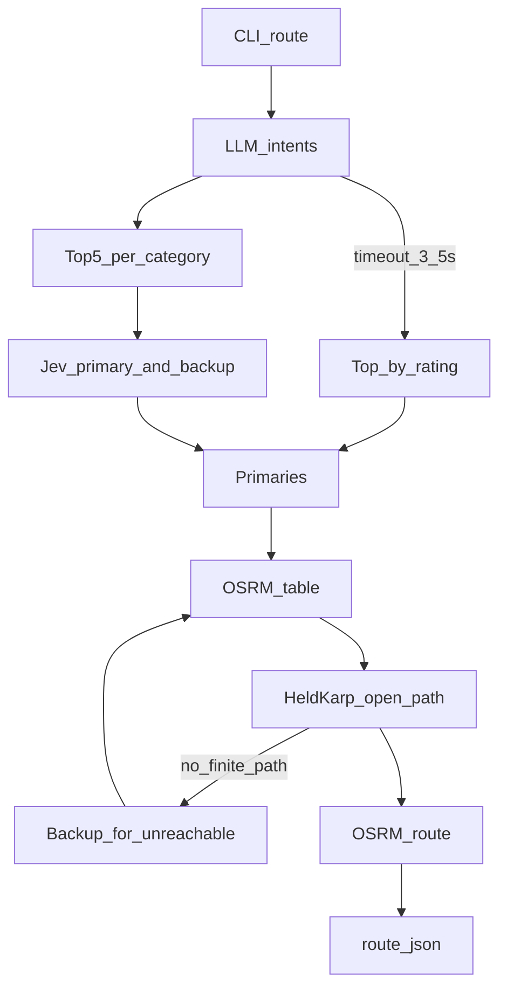

# Скелет бэкенда vk-places

Фронтенд (VK Mini App, VKUI, карта) в этот репозиторий не входит. HTTP-сервера, `api/openapi.yaml` и монолита на Go нет. Точка входа — `python -m rag route`. Ответ печатается и сохраняется в `artifacts/runs/route.json`.

Язык — Python, пакет `rag`. Оркестратор один: граф в `rag/graph.py`. Планировщик, выбор мест и маршрутизация не подменяют друг друга: LLM не возвращает id мест, Jev не строит геометрию, Held-Karp не ходит в базу.

VRPTW, Redis, пул воркеров и текстовые сноски не реализованы. `opening_hours` разбирается при загрузке JSON и в порядок маршрута не входит.

# Поток генерации

`transport_mode` берётся из аргумента CLI (`walk` | `car` | `transit`), не из ответа модели. `walk` → профиль OSRM `foot`, `car` → `car`, `transit` → `foot` и поле `transport_note`: отдельного графа общественного транспорта нет.

1. LLM (`rag/planner.py`), таймаут 3.5 с. Ответ: `route_title`, `required_points` (1–4 кода категорий без повторов), `precedence` (пары «категория A раньше B», только если пользователь это сказал), `fixed_first` / `fixed_last`. Порядок массива `required_points` не задаёт порядок посещения.
2. Если LLM не успела или недоступна — до 4 мест этого города с координатами и разными категориями, по убыванию рейтинга. Jev не вызывается. Дальше те же этапы 3–4.
3. Иначе для каждой категории отдельно: город и категория, топ-5 pgvector по тексту запроса, Jev выбирает основную и запасную. Уже выбранные `org_id` исключаются. Пустая категория пропускается. Если основных точек нет — ошибка.
4. OSRM Table и Held-Karp (`rag/routing.py`) упорядочивают основные точки. Недостижимая основная заменяется запасной. OSRM Route отдаёт полилинию.

# Дерево репозитория

- `rag/graph.py` — оркестратор генерации.
- `rag/planner.py`, `rag/models.py`, `rag/prompts.py` — интенты LLM.
- `rag/store.py` — поиск pgvector (`TOP_K=5`) и топ по рейтингу.
- `rag/jev.py`, `rag/selection.py` — основная и запасная точка.
- `rag/routing.py` — клиент OSRM Table/Route и Held-Karp, N ≤ 10.
- `rag/normalize.py`, `rag/categories.py` — разбор JSON и whitelist.
- `deploy/docker-compose.yml` — Postgres (`pgvector/pgvector:pg16`) и OSRM. Снаружи один адрес `OSRM_BASE_URL`, по умолчанию `http://127.0.0.1:5000`: профили `car` и `foot` собраны из выгрузки Ивановской области.
- `.env.example` — `DATABASE_URL`, ключ и база LLM, `EMBEDDING_DIM=1024`, `OSRM_BASE_URL`.

Метода якорной точки и PostGIS KNN (`<->`) в коде нет. Комбинаторный перебор «все парки × все храмы × все кафе» заменён топ-5 и Jev: в задачу коммивояжёра попадает одна основная точка на категорию.

# Схема данных

Векторная таблица (`VECTOR_TABLE`, по умолчанию `ivanovo_places`): `org_id`, `city`, `category`, `name`, `address`, `type`, `rating`, `reviews`, `lat`, `lon`, `embedding vector(1024)`, HNSW по эмбеддингу. Размерность 1024 (`baai/bge-m3`), не 1536. Колонки `geography` и GiST-индекса нет. Отдельной таблицы `routes` нет: готовый маршрут лежит в `artifacts/runs/route.json`.

Сырой `Иваново.json` уже содержит `coordinates` и рубрику `type`. `load_places` отбрасывает пустой `type`, рубрики вне whitelist и из чёрного списка (бухгалтерия, лизинг, автосервис, склады), а также координаты вне допустимой рамки. Геокодера Nominatim нет. Хвост названия разбирается в `opening_hours`, затем с имени снимается приклеенная оценка. Фрагмент отзыва попадает в текст эмбеддинга; отдельные теги из отзывов не извлекаются. `python -m rag rebuild` считает эмбеддинги и пишет их в таблицу.

Категории: `food`, `culture`, `nature`, `sight`, `entertainment`, `mall`, `station`, `sport`.

# Ответ

`route.json`: `route_id`, `route_title`, `transport_mode`, `total_distance_meters`, `total_duration_minutes`, `waypoints[]` (`order`, `place_id`, `name`, `lat`, `lon`, `category`, `suggested_time`), `route_geometry` (encoded polyline OSRM, precision 5). Для `transit` добавляется `transport_note`.

Если OSRM не запущен или конечного пути нет, команда завершается ошибкой. Полилиния по прямой не подставляется.

# Алгоритм

### Этап 1. Интенты

Запрос вроде «парк, церковь и грузинский ужин» становится категориями `nature`, `sight`, `food`, а не кодами `park` / `church` и не id заведений. `precedence` заполняется только при явном порядке («сначала поесть»). `fixed_last: station` — если маршрут обязан закончиться у вокзала.

### Этап 2. Что посещать

Для каждой категории отдельно, не по цепочке от предыдущей точки:

1. Фильтр: тот же `city` и эта `category`. Радиуса нет: в запросе нет координаты пользователя.
2. pgvector: топ-5 ближайших эмбеддингов к тексту запроса и подписи категории.
3. Jev оценивает только эти 5. `select_pair` берёт основную и запасную. Если Jev недоступен — порядок по дистанции эмбеддинга.

В Held-Karp идёт одна основная точка на категорию. Запасная в перестановках не участвует.

### Этап 3. Порядок

Основные точки (N ≤ 10, фактически ≤ 4) уходят в OSRM Table: `GET /table/v1/{profile}/{lon,lat;...}?annotations=duration,distance`. Ячейка — секунды и метры по дорогам. `null` — нет пути, в матрице это бесконечность. Haversine в стоимость не входит. OSRM Trip не используется.

Ищется открытый путь, не цикл. Критерий — сумма длительностей. При равной длительности побеждает меньшая сумма метров.

Held-Karp, состояние `dp[mask][j]` — минимальная длительность пути по множеству `mask`, который закончился в `j`:

- без фиксированного старта: `dp[1<<i][i] = 0` для каждой точки, у которой нет предшественников в `precedence`;
- с `fixed_first`: нулевое состояние только у этой точки, и только если предшественников у неё нет;
- переход `j → k` допустим, если `k` ещё не в маске и все категории, которые должны быть раньше категории `k`, уже в маске;
- ответ — `dp[(1<<N)-1][end]`, где `end` задан `fixed_last`, иначе минимум по всем концам;
- путь восстанавливается указателями предков.

Если лучшая стоимость бесконечна, недостижимая основная точка заменяется запасной той же категории, и матрица считается заново. Замена по одной категории, пока путь не станет конечным или запасные не кончатся.

### Этап 4. Геометрия и тайминг

Выигравший порядок уходит в OSRM Route: `overview=full`, `geometries=polyline`, `steps=false`. Расстояние и время в пути в ответе — из Route, не сумма Table.

`total_duration_minutes` = минуты пути + сумма визитов. Визит — `avg_visit_duration_min`, если поле пустое: food 90, culture/sight/entertainment 60, nature 45, mall 60, sport 60, station 15. `suggested_time` считается от 10:00: к каждой следующей точке прибавляются визит в предыдущей и нога OSRM между ними. Штрафов по `opening_hours` нет.

Одна точка: Table и Held-Karp не вызываются, геометрия пустая, дистанция 0, длительность равна визиту.
